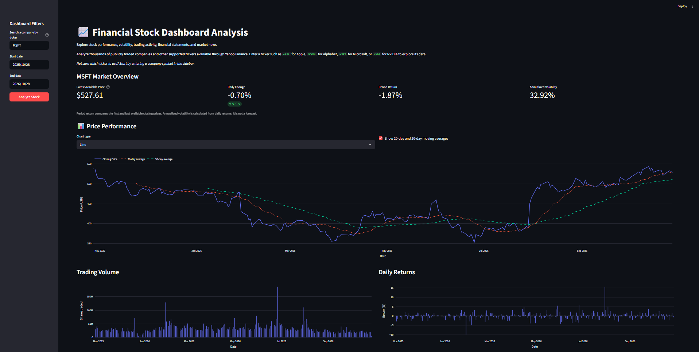

# 📈 Stock Analysis App | Real-Time Financial Dashboard

A web-based stock market analysis dashboard built with **Python and Streamlit** that helps users explore stock price trends, analyze historical performance, review financial statements, and access market news through a single interactive interface.

🌐 **Live Demo:** [Stock Analysis App](https://stockanalysisapp.streamlit.app/)  

---

## 🎯 Problem Statement

Analyzing a stock often requires switching between multiple platforms to access historical prices, financial statements, performance metrics, and market news. This fragmented workflow makes it difficult for users to get a quick, consolidated view of a company's market performance.

The goal of this project is to bring these essential stock analysis capabilities together in one interactive dashboard, making financial data easier to explore and interpret.

## 💡 Solution

I developed a Streamlit-based stock analysis application that combines historical market data, financial statement retrieval, performance indicators, and financial news in a unified interface.

Users can enter a stock ticker, select a date range, and explore price movements and financial information through interactive visualizations and organized data views.

The application is deployed on Streamlit Community Cloud, making it accessible through a web browser without requiring users to install the application locally.

## ✨ Key Features

- **📊 Stock Price Analysis** — Retrieve historical stock market data using Yahoo Finance and examine open-price trends over a selected period.
- **📈 Interactive Visualizations** — Explore stock price movements and market trends using Plotly charts.
- **💰 Performance Metrics** — Review the latest available price, daily price change, period return, and annualized volatility.
- **🏦 Financial Statements** — Retrieve annual balance sheets, income statements, and cash flow statements using the Alpha Vantage API.
- **📰 Financial News** — Access the latest available stock-related news articles through the StockNews library.
- **📅 Custom Date Range** — Select a historical period to analyze stock performance.
- **🌐 Live Deployment** — Access the application online through Streamlit Community Cloud.

## 🛠️ Tech Stack

| Technology | Purpose |
|---|---|
| Python | Core application logic and data processing |
| Streamlit | Interactive web application and user interface |
| Pandas | Data manipulation and analysis |
| NumPy | Numerical computations and financial metrics |
| Plotly | Interactive financial data visualizations |
| yfinance | Historical stock market data |
| Alpha Vantage | Financial statement data |
| StockNews | Stock-related news retrieval |
| Streamlit Community Cloud | Application hosting and deployment |

## 🏗️ How It Works

1. **User input:** The user enters a stock ticker and selects the analysis period.
2. **Market data retrieval:** The application fetches historical stock data through Yahoo Finance.
3. **Data processing:** Python, Pandas, and NumPy are used to prepare the data and calculate performance metrics.
4. **Visualization:** Plotly presents stock trends and other analytical views.
5. **Fundamental analysis:** The application retrieves available financial statements through Alpha Vantage.
6. **News analysis:** Stock-related articles are retrieved through StockNews.
7. **Results:** The user explores the available information through the Streamlit dashboard.

---

## 📸 App Preview

### Live Application Screenshot

